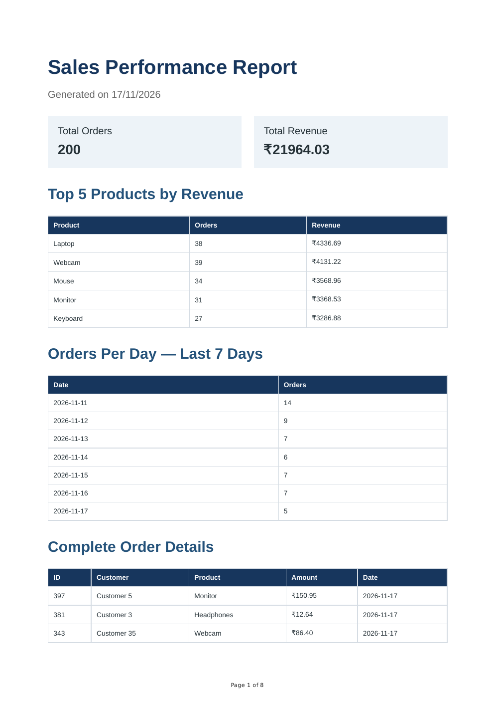

# PDF Report Generator

A Node.js and Express application that generates downloadable PDF sales reports using SQLite and Playwright.

## Dataset

This project uses a simulated sales dataset containing 200 orders. Each order includes an ID, customer, product, amount, and creation date. Six products are included, with order amounts ranging from ₹5 to ₹200 and dates from the last 30 days.

## Technologies

- Node.js
- Express.js
- SQLite (`node:sqlite`)
- Playwright
- Chromium

## Setup

Install dependencies:

```bash
npm install
npx playwright install chromium
```

Install the database seed:

```bash
node seed.js
```

Start the server:

```bash
node server.js
```

The API runs at `http://localhost:3001`.

## Generate a PDF

Generate a standalone test PDF:

```bash
node generatePdf.js
```

The PDF is saved in `reports/test.pdf`.

## API Endpoints

| Method | Endpoint | Description |
|---|---|---|
| GET | `/health` | Health check |
| POST | `/reports` | Generate a PDF report |
| GET | `/reports/:id` | Retrieve report details |
| GET | `/reports/:id/file` | Download the PDF |

Generate a report:

```bash
curl -X POST http://localhost:3001/reports
```

Retrieve report details:

```bash
curl http://localhost:3001/reports/REPORT_ID
```

Download a report:

```bash
curl -o downloaded-report.pdf http://localhost:3001/reports/REPORT_ID/file
```

Force creation of a new report:

```bash
curl -X POST http://localhost:3001/reports \
-H "Content-Type: application/json" \
-d '{"force":true}'
```

## SQL Aggregation Queries

Total orders and revenue:

```sql
SELECT COUNT(*) AS totalOrders,
       ROUND(SUM(amount), 2) AS totalRevenue
FROM orders;
```

Top five products by revenue:

```sql
SELECT product, COUNT(*) AS totalOrders,
       ROUND(SUM(amount), 2) AS revenue
FROM orders
GROUP BY product
ORDER BY revenue DESC
LIMIT 5;
```

Orders per day in the last seven days:

```sql
SELECT DATE(created_at) AS day, COUNT(*) AS totalOrders
FROM orders
WHERE DATE(created_at) >= DATE('now', '-6 days')
GROUP BY DATE(created_at)
ORDER BY day ASC;
```

## Report Generation Pipeline

1. Retrieve and aggregate sales data using SQLite.
2. Generate an HTML report.
3. Use Playwright and Chromium to convert HTML into an A4 PDF.
4. Save the PDF on disk.
5. Store report metadata in SQLite.
6. Serve the PDF through a download API.

## Duplicate Protection

The API checks whether a report has already been generated on the current day and reuses it to prevent duplicate report generation. Sending `{"force":true}` creates a fresh report when required.

In a production system, long-running report generation should be moved to a background job or queue so API requests remain responsive.

## PDF Preview

The generated PDF contains sales totals, the top five products, daily order counts, and complete order details.

